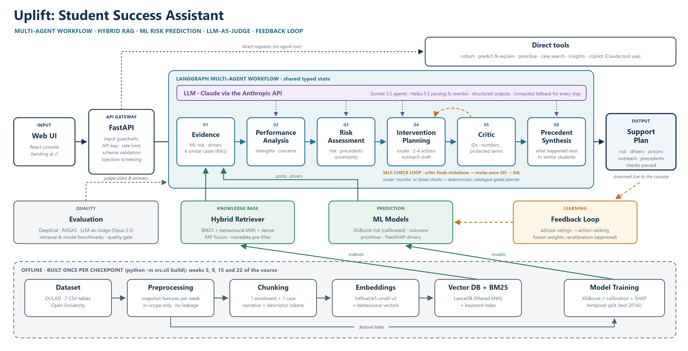
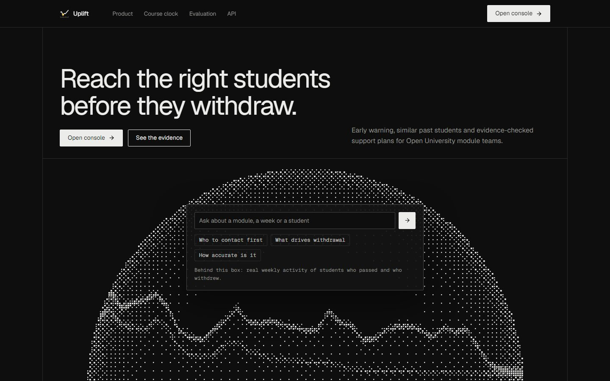
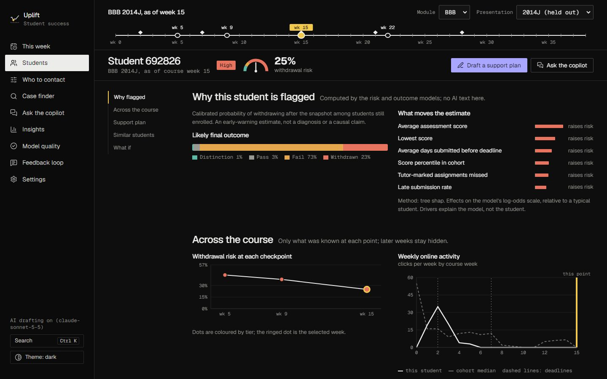

# Uplift: AI-Powered Student Success Assistant

**Participant:** Nishanth · **Domain:** Education (EduTech) · **Dataset:** Open University Learning Analytics Dataset (OULAD)

Uplift helps university module teams find students who may withdraw or fail **while they are still enrolled**, explains
why, shows what happened to similar students in earlier cohorts, ranks who to contact first for the advisor time
available, and drafts a supportive plan and message that an advisor reviews. It is a FastAPI microservice with a React
console, hybrid RAG over historical cases (LanceDB), a LangGraph multi-agent workflow on Claude, calibrated XGBoost
models, and evaluation with DeepEval, RAGAS and an LLM judge.



## Submission deliverables
| # | Deliverable | Location |
|---|---|---|
| 1 | Architecture diagram | [`architecture/Architecture_Diagram.pdf`](architecture/Architecture_Diagram.pdf) (also `.png`, `.jpeg`, `.svg`) |
| 2 | Design document | [`design/Design_Document.pdf`](design/Design_Document.pdf) (source: `design/Design_Document.md`) |
| 3 | Complete source code | [`src/`](src) (backend), [`frontend/`](frontend) (console), [`scripts/`](scripts) |
| 4 | README | this file |
| 5 | API documentation | [`docs/API_Documentation.pdf`](docs/API_Documentation.pdf); live Swagger at `/api/docs` |
| 6 | Dataset details | [`docs/Dataset_Details.pdf`](docs/Dataset_Details.pdf) |
| 7 | Presentation deck | [`presentation/Project_Presentation.pptx`](presentation/Project_Presentation.pptx) (also `.pdf`) |
| 8 | Evaluation report (DeepEval / RAGAS) | [`docs/Evaluation_Report.pdf`](docs/Evaluation_Report.pdf); raw results in [`docs/evaluation/`](docs/evaluation) |
| 9 | Sample test cases | [`tests/`](tests) (139 pytest tests), Evaluation Report section 7, [`docs/evaluation/`](docs/evaluation) |
| + | Sample data | [`data/sample_data/`](data/sample_data) (real OULAD slice, all 7 tables) |
| + | Presenter guide and panel Q&A | [`docs/Presentation_Guide.pdf`](docs/Presentation_Guide.pdf) |

## Project overview
- **Early warning** at four points in a course (weeks 5, 9, 15, 22): calibrated withdrawal risk, tier and
  per-student drivers, plus the likely final outcome.
- **Who to contact first**: a ranking learned for limited advisor capacity, with reasons.
- **Similar students (RAG)**: hybrid search over finished historical enrolments by student or by plain English, with
  metadata filters (course, region, education level, age band, studied credits, previous attempts, outcome).
- **Support plan (multi-agent)**: performance analysis, risk assessment, intervention planning, a critic that checks every
  draft in code, one revision and a deterministic fallback; then a summary of what happened to similar students.
- **Copilot**: questions answered by Claude calling the same tools as the console, streamed, every number checked.
- **Insights, evaluation and feedback**: factors, engagement trends, assessment analytics, fairness audit; DeepEval,
  RAGAS, LLM-as-judge, human review; an approval-gated feedback loop.




## Problem statement
Educational institutions need to identify students who are struggling academically, disengaging from online learning or
at risk of withdrawing, and to support them in time. Module teams hold the data (profiles, assessment results, online
activity, registration history, past outcomes), but reviewing large volumes of learning records by hand is slow and
inconsistent. The brief asks: have students with similar patterns struggled or withdrawn before; which factors are
associated with poor performance or withdrawal; and which students should be prioritised for support?

## Business objective
Contact the right students earlier, with a better first message, so more of them finish the course: fewer withdrawals
and fails per advisor hour; decisions an advisor can explain (drivers and precedents, not a black-box score); supportive,
non-punitive outreach; and a measured, auditable system (every model and AI output evaluated, cost tracked).

## Solution summary
1. **Offline build** (`python -m src.cli build`) turns the seven OULAD tables into snapshot features at each checkpoint
   (only data dated before that day; only students still enrolled), trains calibrated XGBoost models, and indexes every
   finished enrolment as one case in LanceDB (behavioural vectors + e5 embeddings) and a BM25 keyword index.
2. **Online**, `uvicorn src.main:app` serves the REST API and the console. Student and cohort views come from the models;
   case search runs hybrid retrieval with RRF fusion; a support-plan request runs the LangGraph agents with Claude drafting
   text and code checking it; the copilot uses Claude tool calls over the same functions.
3. **Evaluation** runs offline (benchmarks, DeepEval, RAGAS, judge) and on sampled live traffic; advisor feedback becomes
   approved updates.

Key results (week 15, untouched test presentation 2014J):

| Measure | Result |
|---|---|
| Withdrawal risk ROC-AUC (students still enrolled) | 0.726 (95% CI 0.708 to 0.740), logistic baseline 0.703; calibration error 0.009 |
| Ranking precision when contacting the top 10% | 98% later fail or withdraw (random 34%) |
| Retrieval: retrieved students' outcomes predict the query student's (AUC) | 0.835 hybrid vs 0.512 random |
| Agent plans passing every guardrail / LLM-judge pass rate | 100% / 96% |
| DeepEval faithfulness / RAGAS faithfulness (precedent synthesis) | 1.00 / 0.964 |

## Technology stack
| Item | Choice |
|---|---|
| **Programming language** | Python 3.12 (backend, ML, agents); TypeScript (console) |
| **LLM used** | Claude via the Anthropic API: **claude-sonnet-5-5** (agents, copilot, precedent synthesis, briefing), **claude-haiku-5-5** (query understanding, outreach rewrites, note themes), **claude-opus-5-5** (LLM-as-judge, DeepEval and RAGAS evaluator only). Every LLM feature has a computed fallback (`LLM_ENABLED=false`). |
| **Embedding model** | `intfloat/e5-small-v2` (sentence-transformers, 384 dimensions, CPU), chosen over four alternatives by measurement |
| **Vector database** | LanceDB (embedded), one table per checkpoint, metadata pre-filtering, exact kNN; BM25 keyword index alongside |
| **Frameworks** | FastAPI + Uvicorn + pydantic v2 (API); LangGraph (agent workflow); XGBoost, scikit-learn, pandas, NumPy (models and data); sentence-transformers; DeepEval and RAGAS (evaluation); pytest; React 19, Vite, TanStack Query/Table, Recharts, Motion (console) |
| Storage | LanceDB (vectors), SQLite (feedback, jobs, LLM response cache, usage ledger), JSON / CSV artifacts |

Why each was chosen: Design Document, section 4.

## Installation
### Prerequisites
- Python **3.12** (3.10+ works), Git, about 4 GB of disk (PyTorch CPU for embeddings) and 4 GB of RAM.
- Node.js is **not** needed: the console is pre-built in `frontend/dist` and served by the API.
- An Anthropic API key for the AI features (optional: everything runs with computed text without it).

### Environment setup
```bash
git clone <this repository> Nishanth_EduTech && cd Nishanth_EduTech
python -m venv .venv
# Windows (PowerShell):  .venv\Scripts\Activate.ps1      Windows (Git Bash): source .venv/Scripts/activate
# macOS / Linux:         source .venv/bin/activate
```

### Dependency installation
```bash
pip install -r requirements.txt        # all runtime + evaluation + test dependencies (version ranges)
# or, for the exact versions this submission was built and tested with:
pip install -r requirements.lock       # Linux: add --extra-index-url https://download.pytorch.org/whl/cpu
```
Optional extras: `requirements-ragas.txt` (RAGAS, in its own virtual environment: its LangChain dependencies conflict with
the pinned service) and `requirements-docs.txt` (rebuilding the PDFs and diagram; then `python -m playwright install chromium`).

### API key configuration
```bash
cp .env.example .env                   # Windows: copy .env.example .env
```
Edit `.env` (never commit it; it is git-ignored):

| Variable | Purpose |
|---|---|
| `ANTHROPIC_API_KEY` | Claude API key for the AI features. Leave empty, or set `LLM_ENABLED=false`, to run without the LLM. |
| `STUDENT_ASSISTANT_API_KEY` | Key clients send as `X-API-Key`. Generate: `python -c "import secrets;print(secrets.token_urlsafe(32))"` |
| `SSA_DEV_MODE` | `1` disables the API-key check for a local demo; keep `0` anywhere shared. |
| `STUDENT_ASSISTANT_ADMIN_KEY` | Needed only to apply feedback-loop changes (`X-Admin-Key`). |
| `CLAUDE_MODEL_FAST` / `_MAIN` / `_JUDGE` | Model per tier (defaults above). The judge must differ from the generators. |
| `LLM_BUDGET_USD` | Optional spending cap per process (used for evaluation runs). |

### Data
Download OULAD (<https://analyse.kmi.open.ac.uk/open_dataset>) and put the seven CSV files in `data/raw/` (not committed).
Details: [`docs/Dataset_Details.pdf`](docs/Dataset_Details.pdf).

## Local deployment
```bash
python -m src.cli build --no-dense     # features, models, case index, benchmarks at 4 checkpoints (~5 min, no LLM)
python -m src.cli build                # same, plus dense e5 embeddings for plain-English search (~40 min on CPU, once)
uvicorn src.main:app --reload          # API + console
```
Open **http://127.0.0.1:8000** (landing page) and **http://127.0.0.1:8000/today** (console). API reference:
**http://127.0.0.1:8000/api/docs**. If you set an API key (not dev mode), paste it in the console under **Settings**.

Quick check without the full dataset (real OULAD sample, ~1 minute):
```bash
# PowerShell: $env:SSA_HOME=".sample"; $env:SSA_RAW_DIR="data/sample_data"; python -m src.cli build --no-dense
SSA_HOME=.sample SSA_RAW_DIR=data/sample_data python -m src.cli build --no-dense
SSA_HOME=.sample uvicorn src.main:app --reload
```

Optional: AI evaluation and reports (call Claude; responses are cached and spend can be capped with `LLM_BUDGET_USD`):
```bash
python -m src.cli llm-eval             # code checks, LLM judge, A/B, DeepEval, copilot golden set, adversarial prompts
python scripts/ragas_eval.py           # RAGAS (run with the .venv-ragas interpreter, see requirements-ragas.txt)
python -m src.cli quality-gate --with-tests
python -m src.cli report               # model card + presentation from the artifacts
python scripts/build_docs.py           # PDFs, diagram and this README from the artifacts
```
Front-end development (optional): `cd frontend && npm ci && npm run dev` (Vite on :5173, proxies `/api` to :8000).
Docker files are included (`Dockerfile`, `docker-compose.yml`) but not required.

### Tests
```bash
python -m pytest                       # 139 tests, isolated temp home, synthetic fixture, no network, no LLM
```

## Sample queries
Real requests and responses from the running service (full versions in [`docs/API_Documentation.pdf`](docs/API_Documentation.pdf)).
Replace `$KEY` with your `STUDENT_ASSISTANT_API_KEY` (or drop the header in dev mode).

**1. Copilot: "Who should I contact first in BBB 2014J?"** (console: *Ask the copilot*)
```bash
curl -X POST http://127.0.0.1:8000/api/copilot -H "X-API-Key: $KEY" -H "Content-Type: application/json" \
  -d '{"question": "Who should I contact first in BBB 2014J?", "checkpoint": 0.4}'
```
Expected output: a ranked list from the `rank_cohort` tool with withdrawal and fail-or-withdraw risk and the main reasons
per student; student IDs link to their case files; `grounding.passed` is true (every number checked). Excerpt:
```text
Here are the top 10 students to contact in BBB 2014J. The cohort has 1,702 students, and the ranking assumes advisor capacity of 20%. All figures are statistical estimates. [rank_cohort]

| Rank | Student ID | Withdrawal risk | Fail-or-withdraw risk | Main drivers |
|---|---|---|---|---|
| 1 | 692826 | 25% | 96% | Low score, missed assessments, low activity  ...
```

**2. Case search: "students who stopped turning in their coursework"** (console: *Case finder*)
```bash
curl -X POST http://127.0.0.1:8000/api/retrieve-similar -H "X-API-Key: $KEY" -H "Content-Type: application/json" \
  -d '{"query": "students who stopped turning in their coursework", "top_k": 3, "checkpoint": 0.4, "understand": true}'
```
Expected output: the request understood as behaviours
(missed_most, long_inactive_streak, engagement_declining), then the closest historical students with their outcome and
what happened after this point, and the outcome mix of the 50 nearest. First result: case
12429854 (AAA 2014J),
Fail: "finished with fail; weekly activity fell 100% after week 15."

**3. Risk for one student** (console: *Students* > student 692826)
```bash
curl -X POST http://127.0.0.1:8000/api/predict-risk -H "X-API-Key: $KEY" -H "Content-Type: application/json" \
  -d '{"student": {"id_student": 692826, "code_module": "BBB", "code_presentation": "2014J"}, "checkpoint": 0.4}'
```
Expected output: withdrawal risk 25%, tier
**High**, drivers that raise it
(Average assessment score, Lowest score, Average days submitted before deadline), and outcome probabilities
(most likely: Fail).

**4. Support plan for that student** (console: *Draft a support plan*)
```bash
curl -X POST http://127.0.0.1:8000/api/analyze -H "X-API-Key: $KEY" -H "Content-Type: application/json" \
  -d '{"student": {"id_student": 692826, "code_module": "BBB", "code_presentation": "2014J"}, "checkpoint": 0.4, "use_llm": true}'
```
Expected output: the agents' analysis, plan priority "Contact within 2 working days" with actions
from the eligible catalogue (Make a friendly, low-pressure check-in to ask how the module is going; Agree a catch-up plan for missed work, including extension options where policy allows; Mention the confidential student support services that are available, without assuming any cause),
an outreach draft that never mentions risk scores, the critic's checks (`final_plan_violations: []`) and a summary of
what happened to similar students.

**5. Who to contact first at 10% capacity** (console: *Who to contact*)
```bash
curl -X POST http://127.0.0.1:8000/api/prioritize -H "X-API-Key: $KEY" -H "Content-Type: application/json" \
  -d '{"code_module": "BBB", "code_presentation": "2014J", "capacity": 0.1, "limit": 3, "checkpoint": 0.4}'
```
Expected output: the ranked students with `within_capacity`, withdrawal and fail-or-withdraw risk and reasons; first:
student 692826 (Low score relative to cohort; Missed due assessments; Low activity relative to cohort).

## Repository structure
```text
Nishanth_EduTech/
├── architecture/      Architecture_Diagram.pdf / .png / .jpeg / .svg
├── design/            Design_Document.pdf (+ .md)
├── src/
│   ├── api/           FastAPI app, routes, schemas, security, jobs, route documentation
│   ├── agents/        LLM client (Claude), LangGraph workflow, guardrails, copilot, generative features
│   ├── rag/           descriptors and narratives, hybrid retriever, LanceDB vector store, benchmarks
│   ├── services/      student-success service (one model bundle per checkpoint), app storage
│   ├── utils/         settings (config.py) and helpers
│   ├── models/        withdrawal risk, outcome, prioritiser, temporal split, feature contract
│   ├── pipeline/      OULAD to snapshot features (preprocessing, leakage controls)
│   ├── evaluation/    offline AI evaluation, LLM judge, DeepEval, fairness, model and embedding comparisons
│   ├── feedback/      feedback store and improvement loop
│   ├── reporting/     model card and presentation from artifacts
│   ├── cli.py         build / train / index / evaluate / llm-eval / quality-gate / report
│   └── main.py        `uvicorn src.main:app`
├── frontend/          React console (src/ and the built dist/ served by the API)
├── data/
│   └── sample_data/   real OULAD sample (7 tables); raw/ and processed/ are local only
├── docs/              API_Documentation.pdf, Evaluation_Report.pdf, Dataset_Details.pdf, Presentation_Guide.pdf,
│                      evaluation/ (raw results), MODEL_CARD.md, DECISIONS.md, SECURITY.md, DEPLOYMENT.md, ...
├── tests/             pytest suite
├── presentation/      Project_Presentation.pptx (+ .pdf)
├── scripts/           documents, diagram, sample data, RAGAS, API sample capture
├── requirements.txt   (+ requirements.lock exact pins, requirements-ragas.txt, requirements-docs.txt)
├── README.md
└── .gitignore
```

## Responsible use
Uplift recommends; an advisor decides. It is not for grading, admissions or sanctions. Sensitive attributes (gender,
region, deprivation band, age band, education, disability) are never model inputs and never sent to the LLM; they are used
only for the fairness audit and as optional search filters. AI-drafted text is labelled in the console and checked in
code. Details: Design Document section 8, [`docs/SECURITY.md`](docs/SECURITY.md).

## Troubleshooting
| Symptom | Fix |
|---|---|
| `503 service not ready` | Build the artifacts first: `python -m src.cli build --no-dense` |
| `401` from the API or "Can't load the console" | Set `SSA_DEV_MODE=1` for a local demo, or paste `STUDENT_ASSISTANT_API_KEY` in the console's Settings |
| AI sections say "Computed" | No `ANTHROPIC_API_KEY`, or `LLM_ENABLED=false`; everything still works with computed text |
| First plain-English search is slow | The e5 model loads on first use (and downloads once from Hugging Face; set `HF_HOME` to choose the cache folder) |
| `--reload` restarts while installing packages | Use `uvicorn src.main:app --reload --reload-dir src` |

## Data and licence
OULAD: Kuzilek, Hlosta and Zdrahal (2017), *Scientific Data* 4:170171, CC BY 4.0. The full dataset is not redistributed
here; `data/sample_data/` is a small slice for testing the pipeline.
